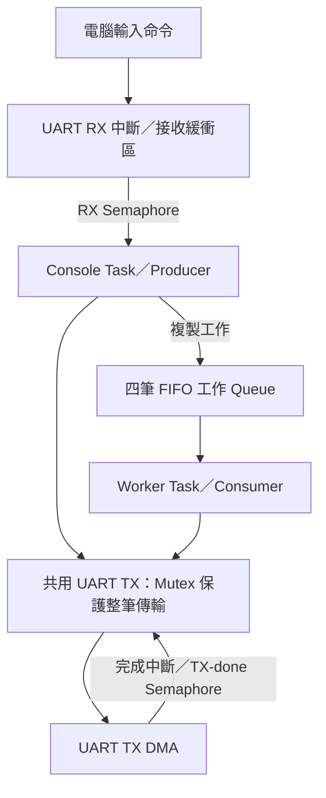

# STM32 UART Workbench

**在電腦輸入命令，由 STM32 背景處理資料並回傳結果。**

這是基於自製 Mini RTOS 的 UART 資料處理終端，支援數值統計與排序工作。Console 接收使用者命令並提交工作，Worker 從佇列取出資料計算；`status` 可查詢工作佇列與累計處理數。

兩個 Task 共用 UART 輸出：Mutex 保護格式化緩衝區與整筆 TX DMA 傳輸，Semaphore 將接收中斷／傳送完成事件交給 Task。所有機制都服務同一個應用，沒有額外的測試模式開關。

## 馬上試用

硬體與原 Mini RTOS 相同：STM32F407VET6、ST-Link、USB-to-TTL。USART1 使用 PA9 TX、PA10 RX；USB-to-TTL 的 **TX 接 PA10，RX 接 PA9，GND 共地**，使用 3.3 V UART 邏輯電位。

> 舊版若只接了 PA9 輸出，這次必須補上 USB-to-TTL TX → PA10，才能從電腦輸入。

1. STM32CubeIDE：**File → Import → General → Existing Projects into Workspace**，選本資料夾。
2. 專案名稱為 `STM32_UART_Workbench`，可與原本的 `Mini_RTOS` 同時保留。Build、Debug；停在 `main()` 時按 F8。
3. Tera Term 開啟對應 COM，設定 **115200、8N1、無流量控制**。
4. **Setup → Terminal** 啟用 **Local echo**，Transmit New-line 選 CR 或 CR+LF。開啟終端後按板上 RESET，可重新看到開機說明。
5. 輸入以下命令並按 Enter：

```text
stats 10 20 30
sort 9 -3 4 4 0
status
```

預期協定範例（`elapsed_ms` 取決於實機，不是固定值）：

```text
QUEUED #1 stats
RESULT #1 stats n=3 min=10 max=30 sum=60 mean=20.000 elapsed_ms=...
QUEUED #2 sort
RESULT #2 sort -3 0 4 4 9 elapsed_ms=...
```

這些是命令／回應範例，不是本版本已完成實機驗證的宣稱。

## 指令

| 命令 | 作用 | 範例 |
|---|---|---|
| `help` | 顯示使用方式 | `help` |
| `stats <整數...>` | 筆數、最小值、最大值、總和、平均值 | `stats -5 10 20` |
| `sort <整數...>` | 小到大排序，保留重複值 | `sort 8 2 8 -1` |
| `status` | 目前工作、待處理工作數、接受／完成／拒絕數與 UART 錯誤 | `status` |

- 命令名稱使用小寫。支援 CR、LF、CRLF 與 Backspace。
- `stats`、`sort` 接受 **1–16 個 signed 32-bit 十進位整數**。總和採 64-bit 整數；平均保留三位小數、向零截斷，計算與輸出不使用浮點。
- 輸入行最多 255 bytes。過長行會整行丟棄並回報錯誤；RX 緩衝區發生資料遺失時，同樣丟棄受影響的行，避免執行殘缺命令。
- 最多四筆工作等候，另可有一筆正在執行。滿載回覆 `BUSY`，本次命令未被接受，可稍後重送；Console 不會阻塞等工作佇列空位。
- `QUEUED #N` 表示命令已被接受；`RESULT #N` 是相同工作的結果。工作編號只在接受成功時增加。

### 展示方式

依序提交 `stats 10 20 30`、`sort 9 -3 4 4 0`，再按「查詢狀態」。用工作編號對應接受與完成的結果。

每筆只有最多 16 個整數，通常很快完成，因此手動操作時看到 worker=IDLE、queue=0/4 是正常的；不以這個操作宣稱長時間忙碌或 Queue 滿載測試通過。

`elapsed_ms` 是計算階段的系統 tick 差值，包含中斷與排程影響，不含排隊及結果傳送等待。解析度為 1 ms，小工作可能顯示 0。

`status` 先取得快照再輸出；`completed` 在工作計算與結果輸出嘗試結束後增加，輸出是否失敗另看 `tx_err`。

## 單一應用裡的角色

| 元件 | 實際責任 |
|---|---|
| Task1 / Console / Producer | 等待接收資料、組合輸入行、解析與檢查命令、提交工作、回覆 help/status/錯誤 |
| Task2 / Worker / Consumer | 等待工作佇列、執行計算、輸出帶編號的結果 |
| 工作 Queue | 複製整筆命令資料；四筆 FIFO；Worker 無工作時阻塞 |
| RX Semaphore | RX ISR 每存入一個 byte 就通知 Console；Console 沒字元時阻塞 |
| TX-done Semaphore | DMA/UART 完成回呼通知正在等待的傳送 Task；完成早於等待時，token 仍保留 |
| TX Mutex | 兩個 Task 共用，從格式化文字開始持有，直到 UART 傳輸完成才釋放 |
| UART TX DMA | 將輸出文字搬到 USART1，降低傳送 Task 的輪詢工作 |
| Idle Task | 所有工作 Task 都不可執行時，使用 WFI 等待中斷 |

兩個 Semaphore 用於不同事件，不是工作 Queue 的替代品。UART 接收中斷只存 byte、通知與重啟接收；不在 ISR 裡解析命令、printf 或取得 Mutex。

## 執行流程



Queue 的滿載策略是拒絕新工作並回覆 BUSY，保留 Console 回應能力；Worker 以阻塞式接收等待工作。UART 輸出持有 Mutex 時，可以阻塞等待 DMA 完成；另一個 Task 若也要輸出，會等待同一把 Mutex。Semaphore 與 Mutex 等待過程均不持續輪詢。

## 模組

| 檔案 | 內容 |
|---|---|
| `Core/Src/main.c` | CubeMX 周邊初始化、對齊的 Task Stack、啟動流程 |
| `Core/Src/workbench.c` | Console／Worker 與應用狀態、命令派送 |
| `Core/Src/work_job.c` | 命令解析、統計、排序 與結果格式化；可在 PC 測試 |
| `Core/Src/msg_queue.c` | 固定容量、值複製的工作 Queue |
| `Core/Src/os.c` | PSP、PendSV、SysTick、兩工作 Task 的排程與啟動 |
| `Core/Src/os_sync.c` | Semaphore、ISR 通知介面、Mutex 所有權交接 |
| `Core/Src/uart_dma.c` | RX ring buffer、RX 中斷、TX Mutex、DMA 完成同步 |
| `Core/Src/stm32f4xx_it.c` | SysTick、USART1、DMA 中斷入口 |
| `tools/workbench_gui.py` | PC 桌面操作介面：選串口、提交工作、查看回應 |
| `tools/send_commands.py` | 選用 PC 串口命令工具 |
| `tests/` | 不需要開發板的演算法、同步與命令流程測試 |
| `docs/` | 操作、驗收與面試說明 |

## 相對原 Mini RTOS 的必要調整

- 保留兩個工作 Task + Idle，增加 UART RX 中斷與固定緩衝區，不需要購買新硬體。
- 統一使用 Mutex 保護 UART，並以 Semaphore 通知 TX 完成，兩個 Task 都可安全呼叫 `UART_Printf()`。
- 加入 `Sem_SignalFromISR()`，保存與恢復 PRIMASK，完成先於等待也不會遺失 token。
- 啟動時先遮罩中斷，再設定 `current_tcb` 與 PSP，完成初始上下文後才開中斷。
- PendSV 保存上下文後，在短臨界區依照最新狀態選擇 Task，避免使用先前已過時的 next-task 決策。
- Task Stack 改為 8-byte 對齊；Console／Worker 各 4096 bytes，Idle 1024 bytes。
- 未使用浮點計算、動態工作配置或 FreeRTOS。周邊初始化與傳輸使用 STM32 HAL。

## PC 工具（選用）

提供 Tkinter 桌面介面，也可繼續使用 Tera Term。Python 版先關閉 Tera Term 釋放 COM 埠：

```powershell
python -m venv .venv
.\.venv\Scripts\python.exe -m pip install -r tools/requirements.txt
.\.venv\Scripts\python.exe tools/workbench_gui.py
```

選擇 COM 埠並按「連線」，在各欄位填數值後按「提交」。結果列會帶工作編號；按「查詢狀態」可看背景工作與 Queue。GUI 只負責送命令與顯示，計算由板子執行。

若要用命令列工具：

```powershell
python -m pip install pyserial
python tools/send_commands.py --port COM3 --demo
```

將 COM3 換成你的實際埠。工具送出示範命令後進入互動模式；輸入 `quit` 結束。

## 驗證與限制

執行 PC 測試（需 GCC）：

```bash
python3 tests/run_tests.py
```

測試使用模擬的 IRQ／HAL 介面，覆蓋計算結果、錯誤輸入、早到／晚到通知、Queue 滿空與喚醒、Mutex 交接、RX 滿載、命令行復原與命令到結果的流程。**它不模擬 ARM Context Switch、實際 NVIC、WFI 或 UART 電氣行為。**

使用 ARM GCC 的獨立驗證編譯：

```bash
python3 tools/build_firmware.py --mode debug
python3 tools/build_firmware.py --mode release
```

實機驗收請依照 [docs/ACCEPTANCE.md](docs/ACCEPTANCE.md)。前一版已由使用者確認開機、接收指令與結果回傳成功；本次精簡版仍需重新燒錄驗收。

目前固定兩個工作 Task，同步物件每個僅支援一個阻塞等待者；本應用的使用方式符合此限制。沒有 priority inheritance、浮點 Task 上下文、傳輸 timeout 或完整故障恢復。硬體完成事件若永久未到，等待者可能持續阻塞；可在 Debug 查看 `os_panic_code` 與 UART 計數。這是學習用途的自製核心，未宣稱為生產級 RTOS。

## 第三方授權

STM32 HAL 與 CMSIS 的版權／授權檔案保留於 `Drivers/`，使用時請一併保留。
